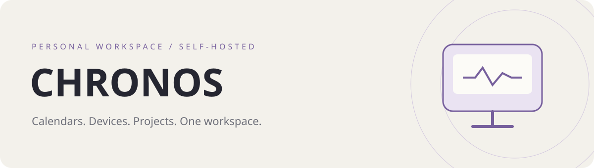

# CHRONOS · 我的工作台

把今日课程、设备状态、服务异常、开源项目和资讯放进同一个自托管工作台。

[项目介绍](https://jimmy-xuzimo.github.io/Chronos-Monitoring/) · [部署指南](docs/deployment.md) · [数据源格式](docs/data-sources.md) · [安全与脱敏](docs/security.md) · [问题反馈](https://github.com/Jimmy-xuzimo/Chronos-Monitoring/issues)



**当前版本：v3 架构。** React / TypeScript / Vite 前端，Flask API，独立后台采集器，SQLite 持久化。这个仓库提供通用源码与虚构示例，不包含作者线上数据、课表、入口地址、数据库或凭证。介绍页中的界面为演示数据，不连接真实设备。

> A self-hosted personal workspace for calendars, server and Windows metrics, service health, GitHub activity, news archives, and bookmarks. Public sources start empty; configure your own after signing in.

## 能做什么

| 模块 | 当前实现 |
| --- | --- |
| 总览 | 中国标准时间秒级时钟、六时段问候、今日课程；无课时展示下一门课的时间与地点；双设备状态及最近 24 小时 CPU / 内存曲线 |
| 课表 | ICS 只读订阅、日 / 周 / 月视图、教师 / 地点 / 节次 / 原始备注；支持重复事件、单次调整、取消及时区解析 |
| 设备 | 云服务器与 Windows 采集节点；每核 CPU、内存、Swap、磁盘容量与读写、网卡、连接数、进程、运行时长 |
| 服务 | HTTP 状态、响应时间、证书剩余天数、故障恢复记录；预期状态码可配置，支持正常登录跳转 |
| 项目 | 公开 GitHub 仓库、参与的公开 PR、合并状态、部分 PR 的 CI / 审阅、最近版本；支持搜索与置顶 |
| 资讯 | 对接自有 JSON 资讯站，按日期与分类归档；每日 07:30 同步，支持手动请求同步 |
| 入口 | 分组、搜索、收藏、拖动排序、改名、关联服务状态；局域网入口可以跳转 |
| 提醒与清理 | 站内异常中心、恢复记录；可设置保留天数，每周清理到期数据 |

### 界面与交互

- 九种风格：纯黑、纯白、工业废土，以及六种马卡龙配色。彩色主题支持深浅模式，纯黑 / 纯白分别固定为对应明暗。
- 课程颜色跟随主题，设置页不提供颜色或时区切换；默认以 `Asia/Shanghai` 展示课程与定时任务。
- 明暗切换按“扩散 / 收回”交替播放，两种动画共用 900ms 非线性曲线；浏览器不支持 View Transitions 时直接切换。
- 首次访问读取设备明暗偏好，之后保存手动选择；尊重系统“减少动态效果”。
- 桌面总览集中展示信息；手机第一页为课表、双设备和项目，入口与资讯单独分页。表格和核心列表分页，避免把完整列表压进屏幕。

### 边界

面向个人登录使用；不是多用户监控平台。课表只读，不回写日历；没有服务器命令执行、重启或远程控制。告警只在站内展示，不发送邮件或推送。Windows Agent 仅主动上报；可使用带配置界面、托盘和登录自启动的原生安装版，也保留 Python 脚本接入方式。

网站可用性来自**面板所在服务器探测**，不代表多地区或所有用户的访问情况。GitHub 状态可能未读取、受限或限流；未读取的检查不会显示为成功。

## 原生客户端

| 客户端 | 使用与构建 | 当前版本 |
| --- | --- | --- |
| Android | [Kotlin / Compose 安卓应用](clients/android/README.md)，连接同一 HTTPS 后端；五套深浅风格、液态玻璃、天气、课表、双设备与设置 | 1.0.1 |
| Windows | [原生电脑采集器](clients/windows-agent/README.md)，安装版、配置界面、托盘、登录自启动、DPAPI 加密凭据 | 1.0.0 |

[下载安装包](https://github.com/Jimmy-xuzimo/Chronos-Monitoring/releases)。公开包默认连接 `https://panel.example.com`，首次使用请填写自己的服务器；没有内置作者账号、Token 或数据。Android 登录凭据与会话以 Keystore 加密保存在手机，Windows 凭据以 DPAPI 加密保存在电脑；业务数据继续在服务器维护。

安卓需要同次更新的天气与外观配置后端接口。天气默认南京，可在设置检索并更改，服务器读取中国气象局网站数据并缓存；来源失效时保留旧数据。完整液态玻璃效果需要 Android 13+，Android 8—12 使用半透明降级背板。

## 快速开始：本地体验

需要 **Python 3.12+、Node.js 22.12+ 和 pnpm 11**。生产环境推荐 Linux；本地 Windows 可运行 API、采集器与前端。

```bash
git clone https://github.com/Jimmy-xuzimo/Chronos-Monitoring.git
cd Chronos-Monitoring
python -m venv .venv
```

安装依赖并构建前端：

```bash
# Linux / macOS；Windows 使用下面的 PowerShell 命令
.venv/bin/python -m pip install -r backend/requirements.lock
cd frontend
pnpm install --frozen-lockfile
pnpm build
cd ..
```

```powershell
# Windows PowerShell 7，在仓库根目录执行
.venv\Scripts\python.exe -m pip install -r backend/requirements.lock
pnpm --dir frontend install --frozen-lockfile
pnpm --dir frontend build
```

首次启动必须自行设置密码。初始账号为 `admin`，仓库**不提供默认密码**。

```bash
export PANEL_INITIAL_PASSWORD='请替换为你自己的长随机密码'
export PANEL_COOKIE_SECURE=0  # 仅用于本机 HTTP 体验
.venv/bin/python backend/app.py
```

```powershell
$env:PANEL_INITIAL_PASSWORD = Read-Host '设置首次登录密码' -MaskInput
$env:PANEL_COOKIE_SECURE = '0' # 仅用于本机 HTTP 体验
.venv\Scripts\python.exe backend\app.py
```

在第二个终端启动采集器，并使用与 API 相同的 `PANEL_DATA` 路径；如未设置，两者默认均使用 `backend/data/`：

```bash
.venv/bin/python backend/collector.py
```

```powershell
.venv\Scripts\python.exe backend\collector.py
```

访问 **http://127.0.0.1:5000/**。第一次初始化后，`PANEL_INITIAL_PASSWORD` 不再覆盖已保存密码，可从环境中移除；账号和密码在“设置 → 安全”修改。

**只启动 API 不会采集指标。** HTTP API 和独立采集器必须同时运行。不要通过启动多个 API 实例来采集数据。

需要前端热更新时，在第三个终端运行 `pnpm --dir frontend dev`；Vite 默认将 `/api` 转发到本机 5000 端口。后端仍需启动，生产环境使用构建后的静态文件。

## 首次配置

公开版的课表、服务、入口和采集节点均为空，GitHub / 资讯数据源默认停用。空白卡片是正常状态。

1. **课表**：添加自己的公网 ICS 链接，填写订阅名称、学期首周日期和周数。已有订阅链接不返回前端，留空表示保留原链接。演示 ICS 见 [examples/calendar.ics](examples/calendar.ics)，需要自行托管到公网 HTTPS 地址。
2. **网站**：填写名称、URL 与预期状态码。需要登录的服务可设置 `200,302` 等预期值；探测不会自动跟随跳转，也不登录目标服务。
3. **入口**：添加 HTTP(S) 地址，可使用局域网 IP 和自定义端口；收藏后优先出现在入口页。入口只跳转，不意味着云服务器能监测局域网服务。
4. **GitHub**：填写自己的用户名；可选 Token 仅保存于服务器。用户名留空停用。Token 不会让面板读取私人仓库。
5. **资讯**：填写自己的资讯站根地址，格式见[数据源说明](docs/data-sources.md)。留空停用，不是任意 RSS 或网页抓取器。
6. **Windows 节点**：按[部署指南](docs/deployment.md#windows-采集节点)注册 Agent 并运行，服务器节点始终由本机采集器提供。

## 架构与目录

```text
浏览器 ──HTTPS── Nginx ── /api/ ── Flask API ── SQLite
                   └── frontend/dist          ↑
                                 独立 collector
                            指标 / 网站 / ICS / GitHub / 资讯
Windows Agent ──主动 HTTPS 上报── /api/agent/report
```

```text
clients/       Android 原生客户端与 Windows 安装版采集器
backend/       Flask API、采集器、Windows Agent、集成与测试
frontend/      React / TypeScript / Vite 工作台源码
config/        Nginx、systemd 示例（专用 chronos 用户）
docs/          部署、数据源与安全说明
examples/      虚构 ICS、资讯 JSON 示例，不含个人数据
scripts/       Agent 注册辅助工具、公开文件检查
website/       GitHub Pages 项目介绍页，与登录面板分开部署
```

## 采集、存储与告警

| 项目 | 默认行为 |
| --- | --- |
| 资源 / Agent | 每 10 秒采样；首页曲线每分钟读取 24 小时历史 |
| 网站 | 每 600 秒探测；证书通常每日检查，失败时可能重试 |
| ICS / GitHub | 每 15 分钟同步；修改相关配置会触发重新同步 |
| 资讯 | 每天中国时间 07:30；未发布、失败时每 15 分钟重试 |
| 原始资源数据 | 保留 1 天 |
| 分钟汇总 | 保留 30 天；查询较长范围时进一步聚合 |
| 探测、已恢复提醒、资讯 | 默认保留 90 天 |
| 清理 | 每周一中国时间 04:00 对应周期执行；停机错过后启动补做，因此到期数据可能额外保留至下一次清理 |

保留时限可在设置修改。运行目录含 `config.json`、`panel.sqlite3` 和锁文件，须持久化并与静态网站隔离。SQLite 使用 WAL；备份、迁移与恢复见[部署指南](docs/deployment.md)。

服务连续失败 3 次进入告警，连续成功 2 次恢复；证书不足 30 天提醒、7 天升为紧急。CPU / 内存持续高负载、磁盘紧张、设备离线也可产生站内提醒。Windows 节点超过 45 秒未上报显示离线，超过 2 分钟产生提醒。

API 返回采集时间与来源状态。同步失败保留上次成功结果并标记过期，不把课表同步异常当作“今天无课”。历史数据来自后台持续采集，关闭浏览器不会中断。

## API 概览

除会话、登录及专用 Agent 上报外，个人数据接口均要求登录。修改接口需要会话中的 `X-CSRF-Token`，Agent 上报改用独立 Bearer Token。

| 路径 | 用途 |
| --- | --- |
| `GET /api/session`、`POST /api/login`、`POST /api/logout` | 会话与登录 |
| `POST /api/credentials` | 修改账号密码，使其他会话失效 |
| `GET /api/overview?node=server` | 汇总数据 |
| `GET /api/stats?node=server` | 当前节点指标，兼容旧路径 |
| `GET /api/history?node=server&range=24h` | 1h / 24h / 7d / 30d 历史 |
| `GET /api/calendar`、`/api/services`、`/api/github`、`/api/news` | 数据源 |
| `GET /api/news?date=YYYY-MM-DD`、`POST /api/news/sync` | 历史资讯与请求同步 |
| `GET /api/services/<id>/history` | 最近 24 小时网站探测记录 |
| `GET /api/alerts`、`POST /api/alerts/seen` | 站内提醒 |
| `GET /api/config`、`PUT /api/config` | 脱敏配置读取与更新 |
| `GET /api/nodes`、`POST /api/agents`、`DELETE /api/agents/<id>` | 节点查看、注册与撤销 |
| `POST /api/agent/report` | Windows 节点上报 |

## 安全与公开版说明

- 密码经 PBKDF2 保存，会话密钥首次随机生成；Cookie 使用 HttpOnly / SameSite，生产必须启用 Secure 并使用 HTTPS。
- 登录节流、CSRF 检查、请求大小限制；订阅拉取校验公网地址，逐跳绑定 DNS 结果，设置大小 / 超时限制。
- 订阅和探测只支持公网 HTTP(S) 的 80 / 443 端口；GitHub Token、订阅 URL、设备 Token 不应写进源码或前端。
- 公网探测不支持私网、回环、链路本地地址及自定义端口；可跳转的局域网入口与可监测对象是两回事。
- 示例 systemd 使用专用用户，采集部分系统信息时可能权限不足；此时应明确显示未知，而非放宽整机权限。
- 没有安全审计或生产 SLA 承诺。详细限制与脱敏清单见[安全说明](docs/security.md)。

## 验证与贡献

```bash
# 已安装后端依赖后；测试另需 pytest
.venv/bin/python -m pip install pytest
.venv/bin/python -m pytest backend/tests -q
pnpm --dir frontend build
python scripts/check_public.py
```

Windows 将 `.venv/bin/python` 替换为 `.venv\Scripts\python.exe`。测试使用临时数据目录与虚构课表 / 节点，不连接个人设备。CI 执行后端测试、前端构建及公开文件检查；介绍页由单独的 Pages 工作流发布。

提交前不要包含 `backend/data/`、运行配置、Token、真实课程、私人入口、数据库、日志或真实设备截图。欢迎通过 Issue / PR 说明复现步骤、操作系统和浏览器版本。

## 常见问题

**登录后一直等待数据？** 检查独立 collector 是否运行、API 与 collector 的 `PANEL_DATA` 是否一致，以及该目录是否可写。

**本地 HTTP 登录后 Cookie 不生效？** 本机体验可设置 `PANEL_COOKIE_SECURE=0`；生产切回 `1` 并通过 HTTPS 访问。

**GitHub 显示未读取？** 公开 PR 列表与逐个查询检查是分开的。无 Token 每轮最多补充最近 1 个进行中 PR，有 Token 为 3 个；其余明确显示未读取。来源受限时保留旧数据。

**资讯不能读取？** 需要 `data/index.json` 和日期 JSON，不能只提供新闻网页。发布当天的日期、站点公网可达性及 JSON 结构都要满足约定。

**时区在哪里改？** 当前界面固定中国时区，课表事件仍按 ICS 自身时区正确解析；不提供界面时区开关。

**忘记密码？** 不要直接删除配置或数据库；它们还保存订阅与设备授权。先离线备份，在服务器上使用 `settings.hash_password()` 更新配置中的密码并递增 `auth_version`，重启 API。具体步骤见[部署指南](docs/deployment.md#恢复账号)。

**从旧版升级？** v3 替换了旧版静态前端和采集方式。不要把新旧进程、运行目录混用；先预览并备份原静态目录、配置、数据库和服务文件，使用独立数据目录迁移后再切换 Nginx。

## 使用许可

延续原仓库说明：本项目可用于个人服务器部署与二次修改。本仓库尚未附标准开源许可证；公开可见不等于 MIT / Apache 授权，其他使用或再分发需求请先联系仓库维护者。
